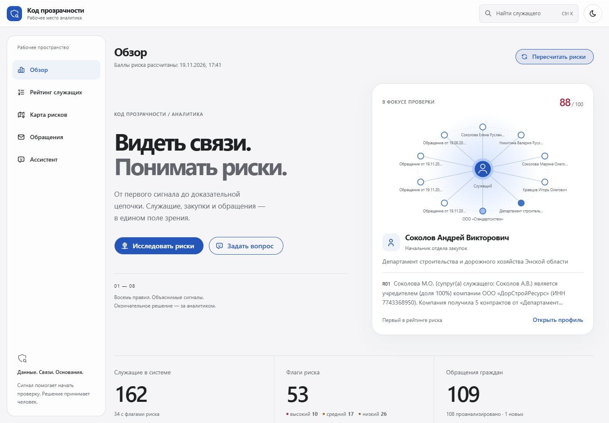
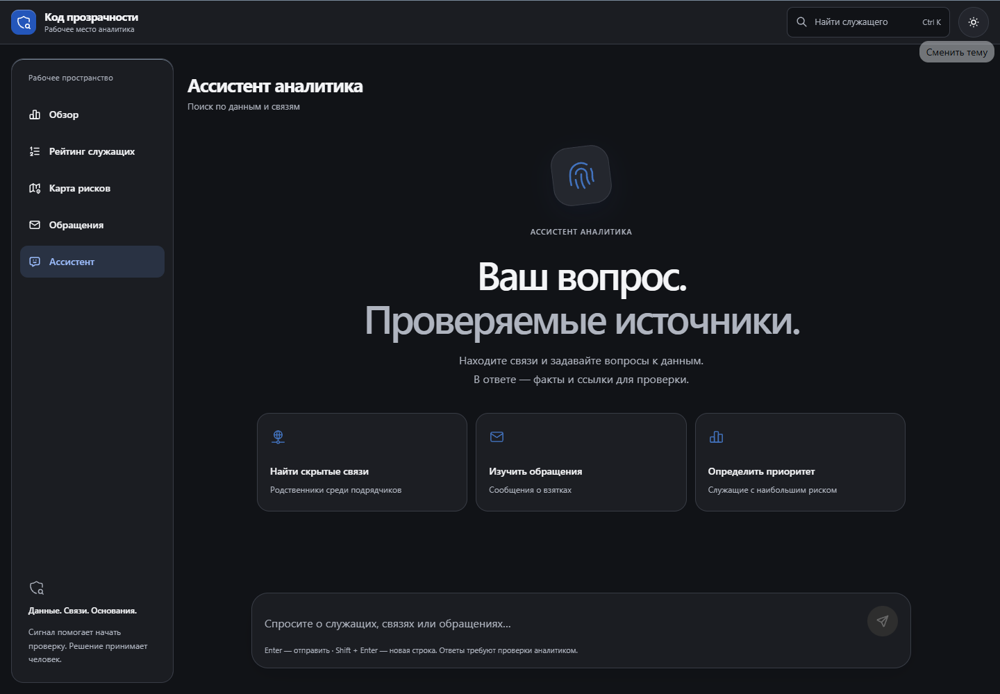

# Рабочее место: визуальная система, этап #52

Ответственный: Егор (`durnoi-chel`). Задача: #52. Этот этап меняет обзор,
ассистент и общие визуальные стили. Поведение профиля, графа, карты рисков и API
сохраняется. При интеграции с #50 / PR #51 общие файлы темы и оболочки требуют
отдельного просмотра: не следует механически складывать две версии оформления.

## Направление

Принципы композиции изучены на [Apple](https://www.apple.com/) и в
[Human Interface Guidelines: Materials](https://developer.apple.com/design/human-interface-guidelines/materials).
Крупная типографика задаёт приоритет; спокойные поверхности оставляют данные
в центре внимания. Полупрозрачность применяется к навигации и панели ввода.
Карточки с данными непрозрачны. Логотипы, изображения и шрифты Apple не используются.

## Токены и компоненты

Источник токенов — `frontend/src/app/global.css` и `editorial.css`.
Основной шрифт — доступный системный Segoe UI Variable / system-ui.
Цифры табличные. Основной акцент — синий `#2456ba`.

| Роль | Светлая тема | Тёмная тема |
| --- | --- | --- |
| Фон | `#f5f5f7` | `#111317` |
| Поверхность | `#ffffff` | `#1c1e23` |
| Основной текст | `#202124` | `#f4f5f7` |
| Вторичный текст | `#62656c` | `#afb4bf` |
| Граница | `#dfe2e7` | `#383c45` |

Обзор: сводные показатели из API, кейс первого служащего в рейтинге,
объяснение самого весомого флага. Мини-граф показывает до 11 реальных узлов и
только существующие между ними рёбра. Это фрагмент, полный граф открывается в профиле.
Сводки ведут в соответствующие разделы, ФИО в таблице доступны с клавиатуры.

Ассистент: три готовых вопроса используют существующий endpoint. После отправки
появляется диалог с источниками; во время запроса доступен статус ожидания.
Пустой ввод не отправляется, Shift+Enter переносит строку, IME-композиция
не отправляет незаконченный текст. Enter отправляет вопрос. Ошибка остаётся
в диалоге; текст можно ввести повторно.

Глобальный поиск: кнопка в шапке или Ctrl/Cmd+K, модальное поле с автофокусом,
Enter открывает рейтинг с URL-параметром `query`, Escape закрывает окно.

## Доступность и адаптация

Видимый focus, ссылка пропуска навигации, подписи кнопок и поля ввода.
Контраст обычного текста — минимум 4.5:1; значимые иконки и focus — минимум 3:1.
Цвет риска дополняется числом и кодом правила. У мини-графа есть текстовая подпись,
имена узлов доступны в SVG title; обзор не заменяет доказательную цепочку в профиле.
При reduced motion отключается движение; при reduced transparency стекло
заменяется непрозрачными поверхностями. На узком экране меню открывается кнопкой,
обзор и подсказки перестраиваются в одну колонку; широкие таблицы прокручиваются
в собственном контейнере. Поле ассистента на мобильном не перекрывает подсказки.

Локальная панель React Query скрыта по умолчанию: включение —
`VITE_QUERY_DEVTOOLS=true` в dev-окружении.

## Проверка

`npm run lint`, `npm run format:check`, `npm run test`, `npm run build`.
`PW_CHANNEL=msedge npm run e2e -- workspace.spec.ts` — реальный локальный API,
граф/профиль, поиск с клавиатуры, ответ ассистента, две темы на 390 и 1440 px.
Полный демо-сценарий запускается на отдельной тестовой БД: он создаёт обращение
и докладную. Снимки до/после сохраняются в локальном `.codex-build`.

Проверено 19.11.2026: lint, format, build, 17 модульных тестов и все 10
Playwright-тестов прошли. Демо повторялось на изолированном локальном стенде;
первый успешный анализ поднял Соколова с 3-го места (73) на 1-е (88).
На повторных прогонах он уже первый. Вторичный текст и обновлённые баллы риска
имеют контраст не ниже 5.28:1 в проверенных сочетаниях палитры.

Для локального Python на Windows дополнительно установлен `tzdata`: системной
IANA-базы здесь нет, а шаблон докладной использует `ZoneInfo('Europe/Moscow')`.
Проверка: `backend/.venv/Scripts/python.exe -c "from zoneinfo import ZoneInfo; print(ZoneInfo('Europe/Moscow'))"`.
При пересоздании окружения после `uv sync` нужно повторить
`uv pip install --python backend/.venv/Scripts/python.exe tzdata`.
Это настройка локального стенда; backend lock-файл в данном этапе не меняется.

## Усиленное движение

По уточнению Егора от 19.11.2026 добавлен более выразительный слой движения
без новых библиотек. Центральная последовательность — раскрытие действительных
связей в мини-графе: узлы, прорисовка рёбер, короткий проход акцента и фиксация кейса.
Заголовки раскрываются по строкам, сводки и балл набираются до точного значения
при попадании в поле зрения, строки рейтинга появляются с ограниченной задержкой.
В профиле анимированы балл, выбор флага и смена доказательной цепочки; в ассистенте —
подсказки, поле ввода и появление сообщений. Данные и бизнес-правила не меняются.

Кнопка воспроизведения в шапке на широком экране повторяет эффекты без перезагрузки
страницы: вопрос, фильтры и выбранный флаг сохраняются. Повторная команда прерывает
предыдущую последовательность. Движение конечное, постоянных фоновых циклов нет;
при скрытой вкладке CSS/WAAPI приостанавливаются, счётчики фиксируют итог.
При reduced motion счётчики сразу показывают итог, пространственные эффекты
отключены, кнопка повтора недоступна. Для скринридеров всегда доступно точное
итоговое число, промежуточные кадры чисел не объявляются.

Выпадающий фильтр использует `floatingStrategy: fixed` и короткое проявление:
это сохраняет корректное положение над страницей при прокрутке и переходах.
При быстром изменении нескольких фильтров отложенный поиск обновляет только
свой параметр; он больше не перезаписывает свежий минимальный балл.

[Короткая запись работающего сайта](design/workspace-motion.mp4).
Проверки движения добавлены в `e2e/workspace.spec.ts`: завершение счётчиков,
повтор, переключение reduced motion, сохранение вопроса и выбранного флага.
Отдельная проверка покрывает быстрый ввод в поиск и минимальный балл.
Итог анимационного этапа 19.11.2026: все 13 браузерных тестов и 17 модульных
тестов прошли, lint/format/build прошли. Механический detector Impeccable
не сообщил замечаний в выбранных файлах движения. В локальном Headless Edge
на 90 кадрах средний интервал составил 13.26 мс без кадров длиннее 34 мс;
это проверка данного стенда, а не гарантия для любых устройств. Обработчик
скрытой вкладки перевёл анимации в paused; после окончания последовательности
в обзоре осталось 0 выполняющихся анимаций.
