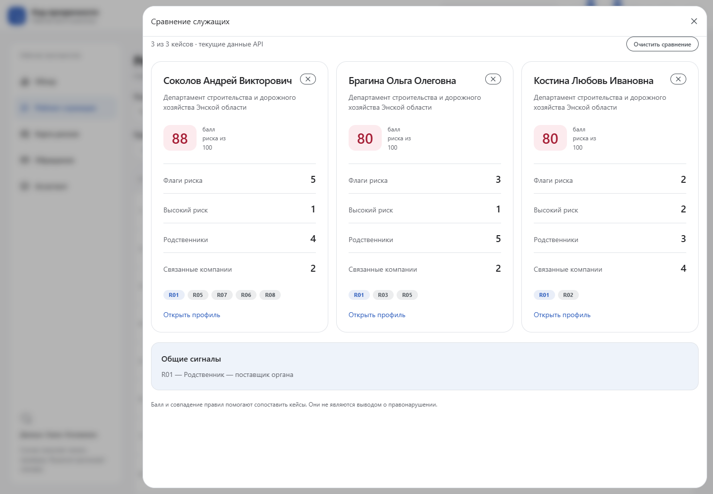

# Инструменты аналитика

Задача #56. Ответственный: Егор (`durnoi-chel`). Основа — PR #53 с дизайном
и анимациями; этот этап добавляет функции, не меняя API и риск-правила.

## Сохранённые кейсы

Кнопка закладки в рейтинге и профиле сохраняет ссылку на служащего. Список
открывается из шапки, на телефоне — через меню «Инструменты аналитика».
Повторный клик удаляет кейс. Из списка можно перейти в профиль и добавить
служащего к сравнению.

Хранение локальное: `localStorage`, ключ `kod-prozr:workbench:v1`, версия схемы 1.
Сохраняются только UUID и последнее показанное имя, до 50 ссылок. Интерфейс явно
пишет «На этом устройстве». Это не серверная учётная запись и не синхронизация
между устройствами. Между вкладками одного браузера синхронизацию выполняет
существующий Mantine hook. Повреждённый JSON, неизвестная версия, неверные UUID
и пустые имена отбрасываются; повторы удаляются, лимиты применяются при чтении.

## Сравнение

Кнопка колонок в рейтинге/профиле добавляет до трёх служащих. Четвёртый не
добавляется, пользователь получает пояснение. Список выбранных также переживает
перезагрузку; сама панель открывается вручную. Кейс можно убрать отдельно или
очистить всё сравнение.

Профили загружаются существующим API, через общий кеш TanStack Query. Сравниваются:

- интегральный балл риска;
- количество флагов и флагов высокой тяжести;
- число уникальных родственников и связанных компаний;
- правила риска, общие для всех загруженных кейсов.

Совпадение правила не объявляется доказательством правонарушения. При ошибке API
вместо показателей видны ошибка и повтор запроса; нули не подставляются.
Общие сигналы показываются только после успешной загрузки всех выбранных профилей.
Количество запросов ограничено тремя; сохранённые ссылки не загружают профили
в фоне. Каждая карточка ведёт к полному профилю.

## Презентация

Кнопка сворачивания панели в шапке скрывает боковую навигацию и расширяет данные.
Повторный клик возвращает обычный экран. Escape выходит из режима, когда не
открыто диалоговое окно. Открытые диалоги получают Escape первыми. Фильтры,
данные и введённые вопросы сохраняются: маршрут и компоненты не перезагружаются.
На телефоне эта команда доступна из меню; кнопка меню разделов также возвращает
обычную навигацию.

## Проверки и интеграция

Unit-проверки модели покрывают повреждённое хранение, версии, уникальность,
лимиты и удаление при заполненном сравнении. Playwright проверяет сохранение
после reload, открытие/удаление, сравнение и предел, данные API, ошибку профиля,
выход из презентации, мобильное меню и отсутствие переполнения.

Ветка начинается от актуального `origin/dev` и включает собственную опубликованную
основу PR #53. Пока #53 не смержен, PR этого этапа в `dev` содержит его коммиты.
Незавершённый код PR #51 и макета PR #55 не переносился. Общие файлы оболочки,
таблицы и профиля при интеграции требуют отдельного просмотра.

Итог проверки 19.11.2026: 19 unit-тестов и полный набор из 18 Playwright-тестов
прошли; lint, format и production build прошли. Проверены компьютер и телефон,
светлая/тёмная темы, отсутствие ошибок JavaScript и переполнения. Detector по
новому модулю не сообщил замечаний.

