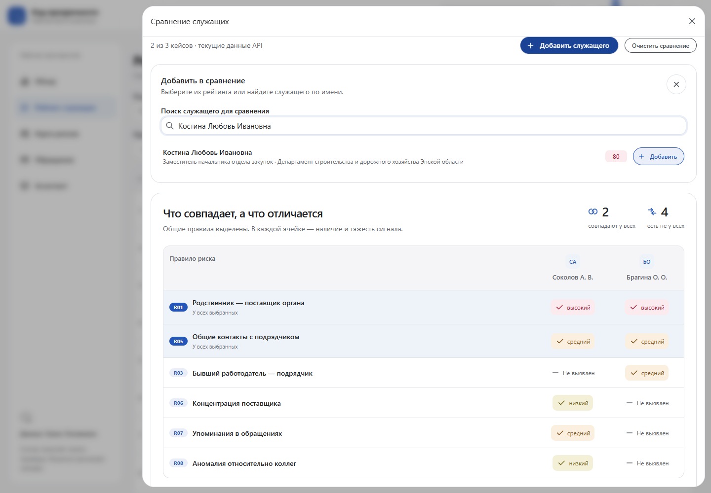

# Инструменты аналитика

Задача #56. Ответственный: Егор (`durnoi-chel`). Основа — PR #53 с дизайном
и анимациями; этот этап добавляет функции, не меняя API и риск-правила.

## Сохранённые кейсы

Кнопка закладки в рейтинге и профиле сохраняет ссылку на служащего. Список
открывается из шапки, на телефоне — через меню «Инструменты аналитика».
Повторный клик удаляет кейс. Из списка можно перейти в профиль и добавить
служащего к сравнению.

Хранение локальное: `localStorage`, ключ `kod-prozr:workbench:v1`, версия схемы 1.
Сохраняются только UUID и последнее показанное имя, до 50 ссылок. Интерфейс явно
пишет «На этом устройстве». Это не серверная учётная запись и не синхронизация
между устройствами. Между вкладками одного браузера синхронизацию выполняет
существующий Mantine hook. Повреждённый JSON, неизвестная версия, неверные UUID
и пустые имена отбрасываются; повторы удаляются, лимиты применяются при чтении.

## Сравнение

Кнопка колонок в рейтинге/профиле добавляет до трёх служащих. Четвёртый не
добавляется, пользователь получает пояснение. Список выбранных также переживает
перезагрузку; сама панель открывается вручную. Кейс можно убрать отдельно или
очистить всё сравнение.

В самой панели всегда есть кнопка «Добавить служащего». Она открывает встроенный
поиск по ФИО/должности и список из API; выбранные служащие исключены. Можно
добавить первый, второй и третий кейс без перехода в рейтинг. После добавления поле поиска очищается и готово к следующему выбору. На свободном месте
также есть действие «Добавить ещё». При трёх кейсах кнопка отключена с пояснением;
после удаления кейса добавление снова доступно. Запрос поиска отложен на 250 мс,
пока результат обновляется, старые варианты нельзя выбрать.

Профили загружаются существующим API, через общий кеш TanStack Query. Сравниваются:

- интегральный балл риска;
- количество флагов и флагов высокой тяжести;
- число уникальных родственников и связанных компаний;
- правила риска, общие для всех загруженных кейсов.

Совпадение правила не объявляется доказательством правонарушения. При ошибке API
вместо показателей видны ошибка и повтор запроса; нули не подставляются.
Матрица общих и отличающихся сигналов показывается над карточками после успешной
загрузки всех выбранных профилей. Строки — правила, столбцы — люди; общие правила
выделены, наличие и тяжесть сигнала обозначены текстом, цветом и отметкой.
Несколько флагов одного правила объединяются в ячейку с количеством и максимальной
тяжестью. Отсутствие флага остаётся явным «Не выявлен». На телефоне вместо широкой
таблицы показаны карточки правил со всеми выбранными людьми без боковой прокрутки.
Совпадение правила не объявляется связью между служащими.

Одновременно загружается не более трёх профилей; поиск — отдельный ограниченный
запрос до десяти результатов. Сохранённые ссылки не загружают профили в фоне.
Каждая карточка ведёт к полному профилю.

## Презентация

Кнопка сворачивания панели в шапке скрывает боковую навигацию и расширяет данные.
Повторный клик возвращает обычный экран. Escape выходит из режима, когда не
открыто диалоговое окно. Открытые диалоги получают Escape первыми. Фильтры,
данные и введённые вопросы сохраняются: маршрут и компоненты не перезагружаются.
На телефоне эта команда доступна из меню; кнопка меню разделов также возвращает
обычную навигацию.

## Проверки и интеграция

Unit-проверки модели покрывают повреждённое хранение, версии, уникальность,
лимиты и удаление при заполненном сравнении. Playwright проверяет сохранение
после reload, открытие/удаление, сравнение и предел, данные API, ошибку профиля,
выход из презентации, мобильное меню и отсутствие переполнения.

Ветка начинается от актуального `origin/dev` и включает собственную опубликованную
основу PR #53. Пока #53 не смержен, PR этого этапа в `dev` содержит его коммиты.
Незавершённый код PR #51 и макета PR #55 не переносился. Общие файлы оболочки,
таблицы и профиля при интеграции требуют отдельного просмотра.

Итог проверки 19.11.2026: 19 unit-тестов и полный набор из 18 Playwright-тестов
прошли; lint, format и production build прошли. Проверены компьютер и телефон,
светлая/тёмная темы, отсутствие ошибок JavaScript и переполнения. Detector по
новому модулю не сообщил замечаний.

Уточнение сравнения 19.11.2026: нижняя строка заменена на матрицу совпадений
и различий; добавление работает внутри панели после первого и второго выбора.
Проверены полный набор из 19 браузерных тестов и отдельно добавленный мобильный
сценарий (итого 20), 21 unit-тест, lint/format/build. Снимки проверены на 1440/390 px
в двух темах, ошибок JavaScript и переполнения не выявлено. При проверке сохранённых
кейсов тест явно дожидается завершения закрытия панели перед действием в профиле.

